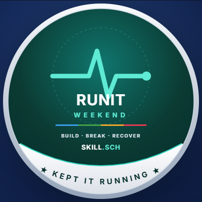

# RunIt

A small Python web app packaged with Docker. It includes a health endpoint, a basic availability smoke check, and a rollback exercise.

## Live app

[Open RunIt on Azure Container Apps](https://runit-app.agreeablepond-d459ef37.northeurope.azurecontainerapps.io)


## Certificate

[](https://skill-sch.com/certificate/runit-harden-b997fd8ea1cd)

## Endpoints

| Path | Purpose |
| --- | --- |
| `/` | Displays the RunIt home page |
| `/health` | Returns `{"status": "ok"}` when the HTTP server responds |

The health endpoint checks that the process is responding. It does not verify that every user-facing feature is working.

## Run locally with Docker

```bash
docker build -t runit-app:local .
docker run --rm --name runit-app -p 8080:8080 runit-app:local
```

Open [http://localhost:8080](http://localhost:8080). Check the health endpoint with:

```bash
curl http://localhost:8080/health
```

## Availability check

`check.sh` sends 20 requests to the home page and reports the number that return HTTP 200:

```bash
export APP_URL="https://runit-app.agreeablepond-d459ef37.northeurope.azurecontainerapps.io"
./check.sh "$APP_URL"
```

The script considers 19 of 20 successful requests (95%) a pass. This short smoke check is not a measurement of the stated 99.5% availability objective over 30 days.

## GHCR permissions and package access

The workflow needs permission to publish the container image:

- The workflow token must have `packages: write` in `.github/workflows/deploy.yml`.
- In the GHCR package settings, open **Manage Actions access** and grant the repository `joinsslabs/runit` the **Write** role. `joinsslabs` is a personal GitHub account, so use the package page under `/users/`, not `/orgs/`.
- The package appears after the first successful image push. If a workflow fails with `permission_denied: write_package`, check these workflow and package permissions.

The package can remain private for GitHub Actions to push it. Render or Azure needs separate permission to pull a private image: either make the package public, or configure a registry credential with `read:packages`. A public package can be pulled by anyone. The Dockerfile's `org.opencontainers.image.source` label links the image to its source repository; it does not grant registry access.

## Build and deployment

The GitHub Actions workflow in `.github/workflows/deploy.yml` runs on pushes to `main` and manual dispatches. It builds an image, pushes it to GitHub Container Registry with a short commit-SHA tag, and triggers a Render deploy hook.

The Azure URL above is the Azure Container Apps deployment. The current workflow deploys through Render; it does not automatically update Azure.

## Rollback and incident notes

To revert a problematic commit and trigger the workflow again:

```bash
git revert <commit>
git push
```

See the [incident postmortem](postmortem.md) for the failure scenario and follow-up actions.
